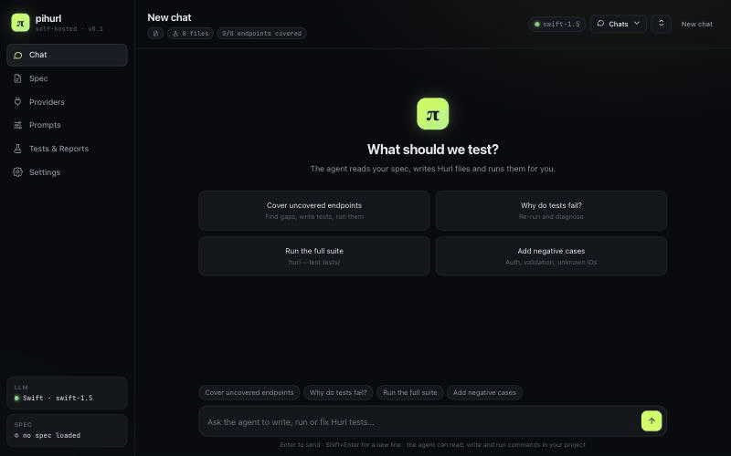
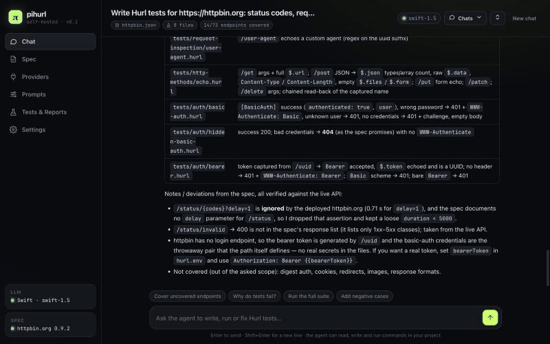
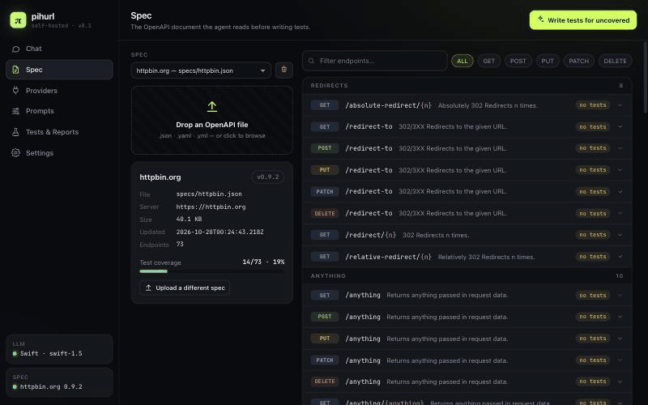
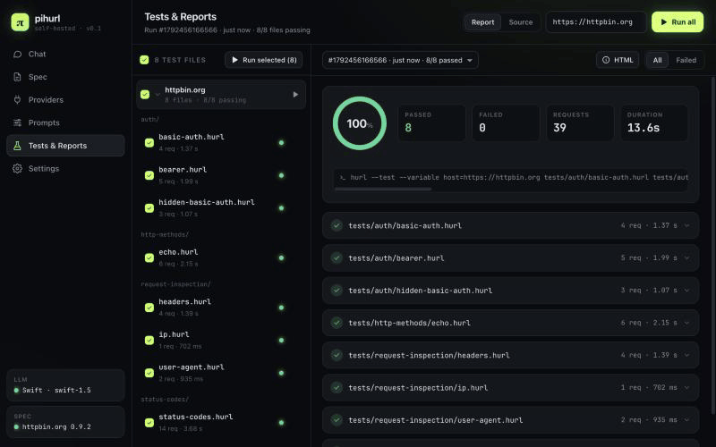
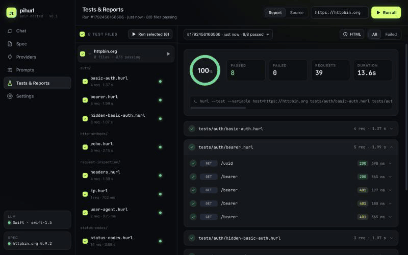

# pihurl

A self-hosted web tool for testing HTTP APIs with an LLM agent. Give it an OpenAPI spec (or let the
agent write one), connect a model — a local one such as Ollama, or a cloud provider — and ask it
for tests. The agent writes [Hurl](https://hurl.dev) files, runs them and fixes them; **pihurl itself
runs the tests**, so results are reproducible and do not depend on the model's mood. Everything
happens in the browser, in one Docker image.



*A local model is asked to test [httpbin](https://httpbin.org): it finds the published OpenAPI spec,
writes eight Hurl files, and pihurl runs them (8/8 files, 39 requests). Waiting time is cut.*

- **Chat with an agent** that can read your spec, write and edit test files and run commands. It is
  [pi](https://github.com/earendil-works/pi), run in RPC mode inside the container.
- **Specs**: upload OpenAPI 3 / Swagger 2 files, or ask the agent to create one from an API's docs
  or by probing it. Specs the agent writes show up in the UI on their own.
- **Tests grouped by spec**: every test file is filed under the spec it exercises; select, run and
  collapse whole groups.
- **Runs and reports**: run all, a group, or a selection; per-request results with assertions and
  bodies, Hurl's own HTML report, JUnit and JSON, and a history of runs.
- **Send failures to the agent** with one click and let it decide whether the test or the API is
  wrong.
- **Any model**: Ollama, LM Studio, vLLM and other OpenAI-compatible servers, OpenAI, Anthropic,
  OpenRouter. Temperature and context window are set per provider.
- **Projects**: one pihurl serves several APIs. Each project has its own specs, tests, reports, target host,
  instructions and chats, and each browser tab can be in a different one.
- **Parallel chats**: start a second chat while the first is still working; both agents run at once, the
  Chats menu shows which are busy, and a second tab on the same chat follows it live.
- **Chats persist** across reloads, restarts and provider changes; there is an application log for
  checking what the agent did.

## Screenshots

| Chat with tool calls and a Markdown answer | The spec the agent found |
|---|---|
|  |  |

| Tests grouped by spec, run results | One test file's requests and assertions |
|---|---|
|  |  |

## Quick start

You need Docker.

```bash
git clone <this repository> pihurl && cd pihurl
docker compose up -d --build
```

Open <http://localhost:3000>, then:

1. **Providers** → add your model (for Ollama on the host use `http://host.docker.internal:11434/v1`).
   *Test connection*, *Save*.
   For local models also set the *context window*, and give Ollama the same size
   (`OLLAMA_CONTEXT_LENGTH`); its default is small and long chats are silently cut.
2. **Spec** → drop an OpenAPI file, or skip this and ask the agent in the chat to create a spec for
   an API you name.
3. **Tests & Reports** → type the base URL of the API under test in the field at the top.
4. **Chat** → "Cover the uncovered endpoints", then **Run all** on the Tests tab.

Without Compose: `./run.sh [port]` builds the image and starts it in the foreground.

Two volumes: `./work` is the agent's workspace (specs, tests, reports, chat transcripts; the first project
is the folder itself, others are in `.projects/`) and is yours to browse and edit; the named volume
`pihurl-state` (mounted at `/state`) holds what the agent must not see: provider API keys, the chat indexes
and the logs. Delete both to start over.

Up to four agents (chats) run at once; change it with `PIHURL_MAX_AGENTS`.

To protect the UI with a token, start it with `PIHURL_TOKEN` set (`openssl rand -hex 24` makes a good one):

```bash
PIHURL_TOKEN=$(openssl rand -hex 24) docker compose up -d   # then write the token down: it is asked once per browser
```

## How it works

```
Browser ── HTTP / SSE ──▶ backend (Node, Hono)
                           ├─ /api/chat       ⇄  pi --mode rpc   (cwd /workspace)
                           ├─ /api/specs      →  /workspace/specs/*
                           ├─ /api/providers  →  models.json, restarts the agent
                           ├─ /api/run        →  hurl --test --report-json/-html/-junit
                           └─ /report/*          run reports
```

The agent's project folder and the server's private state are separate:

```
/workspace                 owned by the agent user; this is the "default" project
├── AGENTS.md              instructions the agent reads (editable in the UI)
├── specs/                 OpenAPI documents
├── tests/<tag>/*.hurl     tests written by the agent
├── hurl.env               host=<the target API>, used by the agent's own hurl runs
├── report/<run id>/       Hurl reports and the normalised result of each run
├── .pi/                   models.json (no keys), skills, chat transcripts
└── .projects/<id>/        every other project: the same layout again

/state                     root only (0700), invisible to the agent
├── providers.json         providers including their API keys
├── projects.json, projects/<id>/   project list; per project the chat index, hosts, defaults
└── logs/pihurl.log        application log (JSON lines)
```

Developer documentation (endpoints, configuration, log events, tests) is in
[`server/README.md`](server/README.md).

## Security

pihurl is meant for a trusted machine or network. What it does about it, and what it cannot do:

- **The agent is unprivileged and cannot see your secrets.** The server runs as root inside the container
  and starts pi, and every command the agent runs, as an unprivileged user (uid 10001). That user can
  read and write `/workspace` and nothing else that matters: `/state` is root-only, `/proc/<server>/environ`
  is closed to it, and its environment is a short allow-list (no token, no keys). The agent still
  has network access and a shell in its sandbox: it can run any command inside the container and reach any
  host the container can reach. Treat the container as the sandbox.
- **Provider API keys never reach the agent.** `providers.json` is in `/state`. pi is configured with a
  loopback proxy (`127.0.0.1:3001`, never published) as its model endpoint and a placeholder key; the
  server's proxy forwards the request and adds the real key, and only below the provider's own base path.
  The agent can use the model through that proxy, but it cannot read the key or the real endpoint address.
- **Access token.** Set `PIHURL_TOKEN` (or `PIHURL_TOKEN_FILE`) and the UI asks for it; the API and reports
  need it as a session cookie (browser) or `Authorization: Bearer <token>` (scripts). Failed sign-ins are
  limited to 10 per address per 5 minutes. Without a token there is no sign-in: the port is published on
  `127.0.0.1` only, and the server only answers to `localhost`, `127.0.0.1`, `[::1]` and
  `host.docker.internal` (add more with `PIHURL_ALLOWED_HOSTS`), which blocks DNS-rebinding attacks from web
  pages. Requests that change something and come from another origin are refused in both modes.
- **Traffic is not encrypted.** Put pihurl behind a TLS reverse proxy before it leaves the machine; the session
  cookie is marked `Secure` when the proxy sends `X-Forwarded-Proto: https`.
- **Hardened container.** The Compose file drops all capabilities except those the server needs to hand
  the workspace to the agent user, and sets `no-new-privileges`.
- **What is not covered.** Anything the agent prints ends up in its chat transcript (`.pi/sessions`), and a
  hostile API can try to prompt-inject the agent. Tests change data: point the target host at a test
  environment. Older chat transcripts from before this layout may contain keys or addresses the agent printed.

On Linux, run the agent as your own user so that `./work` stays yours:
`PIHURL_UID=$(id -u) PIHURL_GID=$(id -g) docker compose up -d`.

## Development

```bash
cd server
npm ci
npm run build && npm start          # http://localhost:3000, state in ~/.pihurl
npm test                            # backend tests
node --test ../web-ui/*.test.js     # UI tests (Markdown renderer, test grouping)
```

Linting (ESLint, for the web UI) runs from the repository root: `npm ci && npm run lint`. The backend is type-checked
with `npm run typecheck` in `server/`.

Browser tests drive the built image with a scripted model and a tiny target API, so they need neither an LLM
nor the internet: `docker build -t pihurl . && e2e/run.sh pihurl` (Docker and Node; the first run downloads
Chromium).

Hurl must be on `PATH` when running outside Docker. The web UI is plain files in `web-ui/` and has no
build step: `app.js` is the entry point (events and start-up), and `js/` holds one ES module per
view (`chat`, `spec`, `providers`, `prompts`, `tests`, `settings`, `projects`) plus the shared `core`, `api`,
`hurl` and `nav`. See [`server/README.md`](server/README.md) for the details.

## CI and releases

GitHub Actions (`.github/workflows/ci.yml`) runs on every push and pull request: type check, backend and
UI tests, then it builds the Docker image, starts it and checks that it answers and ships Hurl
(`scripts/docker-smoke.sh`, which you can also run locally against your own build). A separate job runs the
browser tests (`e2e/`, Playwright) against the image: sign-in, a chat in which a scripted model writes and
runs a test, specs written by the agent, test groups, settings, and a probe of what the agent can and cannot
see.

**Publishing to Docker Hub** is on as soon as the repository has an Actions *variable*
`DOCKERHUB_USERNAME` and an Actions *secret* `DOCKERHUB_TOKEN` (a Docker Hub access token with
read/write scope). Without the variable, forks included, the publish steps are skipped.

| Event | Tags pushed to `<user>/pihurl` |
|---|---|
| tag `v1.2.3` | `1.2.3`, `1.2`, `1`, `latest` (no bare `0` tag for `v0.x`) |

Pushes to `main` and pull requests only build the image and smoke-test it; nothing is published. To
release: `git tag v1.2.3 && git push origin v1.2.3`.

Images are built for `linux/amd64` and `linux/arm64`. The official image is
[`0allitter0/pihurl`](https://hub.docker.com/r/0allitter0/pihurl); to use a published image:

```bash
docker run -d --name pihurl -p 127.0.0.1:3000:3000 -v "$PWD/work:/workspace" \
  --add-host=host.docker.internal:host-gateway 0allitter0/pihurl:latest
```

Dependabot keeps the GitHub Actions, the npm packages of `server/` and the base image up to date.

## License

[MIT](LICENSE). Third-party components and their licenses are listed in
[`THIRD_PARTY_NOTICES.md`](THIRD_PARTY_NOTICES.md). pihurl is an independent project and is not
affiliated with pi, Hurl or any model provider.
